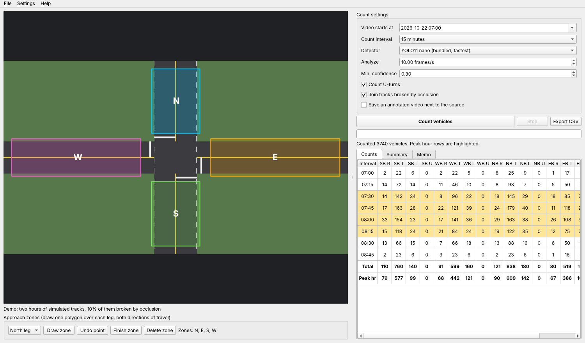

# Turning Movement Counter

A Windows desktop app that turns intersection video into turning movement counts.

Open a traffic camera or phone video of an intersection, draw one zone over each leg, and the app detects every vehicle with YOLO, follows it through the intersection with ByteTrack, and works out where it came from and where it went. You get 15-minute (or 5-minute) counts for every movement (northbound left, eastbound through, and so on) by vehicle class, the peak hour, the peak hour factor and the heavy vehicle percentage, exported as the count sheet layout traffic engineers already use. An optional Claude-written memo summarizes the count from the computed table.

> Student-built tool. The counts are automated: spot check them against a hand count before relying on them.



## Download

Grab `TurningMovementCounter-windows.zip` from the latest [release](../../releases/latest), unzip it anywhere, and run `TurningMovementCounter.exe` inside the folder. No install and no Python needed. Windows SmartScreen may warn because the exe is unsigned; choose "More info" then "Run anyway".

The YOLO26 nano model is bundled, so counting works offline. The larger models in the Detector list download once (from the Ultralytics GitHub releases) the first time you pick them and are kept in `%APPDATA%\TurningMovementCounter\models`. It runs on a laptop CPU (CPU-only PyTorch keeps the download small); at the default 10 analyzed frames per second expect very roughly real time or slower on a laptop, depending on the CPU and video resolution.

Every push to `main` also builds the zip as a GitHub Actions artifact.

## How to count an intersection

1. **File > Open video.** Any MP4, MOV, AVI or MKV. A camera high up on a pole or a building works best; a phone on a tripod at a corner works too.
2. **Draw the zones.** Pick a leg (North, East, South, West: the real compass legs, whatever way the camera faces), click Draw zone, click the corners of a polygon covering that leg's lanes in both directions a car length or two back from the stop bar, then Finish zone (or right-click). Do every leg the intersection has; a T-intersection has three. Save zones writes `<video>.zones.json`, which loads automatically next time.
3. **Set the clock time** the video starts at and the interval.
4. **Count vehicles.** The progress bar shows the minutes processed. Stop keeps the counts so far.
5. **Read the results.** The Counts tab highlights the peak hour rows; Summary has the peak hour, PHF, approach totals, classes and tracking stats; Memo writes a one page summary. **Export CSV** writes the count sheet and a long-format CSV for Excel pivots.

No video handy? **Help > Run demo count** counts two hours of simulated traffic on a drawn intersection so you can see every part of the app.

## How it works

| Step | What happens |
| --- | --- |
| Detection | Ultralytics YOLO26 (COCO classes car, motorcycle, bus, truck) on every Nth frame, 10 per second by default |
| Tracking | ByteTrack keeps one ID per vehicle across frames |
| Ground point | The bottom center of each box, where the tires meet the road, is tested against the zones |
| Movement | First leg visited = entry, last leg = exit. Turn comes from the clockwise order N, E, S, W: one leg over is a left, two is through, three is a right, the same leg is a U-turn |
| Debounce | A zone visit needs 2 consecutive points inside it, so a box flickering on a zone edge never counts; returning to the same leg is only a U-turn after 1 s outside it |
| Broken tracks | When a car is hidden behind a truck its track splits in two. A half that entered one leg and vanished is joined to a half that appeared shortly after (within 2 s and 8% of the frame diagonal) and left by a different leg, so the vehicle counts once instead of not at all |
| Class | Majority vote over the track's frames |
| Intervals | Movements are timed when the vehicle leaves its entry zone and binned into 15 or 5 minute intervals |
| Peak hour | The four consecutive 15-minute intervals with the highest total; PHF = peak hour volume / (4 x highest 15-minute volume), per the Highway Capacity Manual |

A track seen in only one leg is never counted, so the errors lean toward undercounting rather than double counting.

## Verification

`tests/` checks the counting logic with synthetic tracks where the true count is known exactly:

- All 12 turning movements plus U-turns are named correctly from the driver's point of view
- One hour of clean simulated tracks (about 1,900 vehicles) matches the true count exactly, per movement and per class
- With 30% of tracks broken by simulated occlusion, joining the halves brings the count back to within 2% of the truth (without joining, more than 20% of vehicles are lost)
- Zone-edge jitter does not create phantom U-turns; a real U-turn is counted, and dropped when U-turns are off
- Peak hour, PHF and heavy vehicle percentage on hand-made 15-minute volumes (PHF = 500 / (4 x 150) = 0.83)
- Count sheet CSV column layout

The Actions build also runs the packaged exe's self test, which loads the bundled YOLO model and runs the tracker.

**Not yet measured:** accuracy of the YOLO detection and tracking on real footage against a hand count. That is the next step, and the number will go here.

```
pip install torch torchvision --index-url https://download.pytorch.org/whl/cpu
pip install -r requirements.txt
python -m pytest
```

## Run from source

```
python -m turning_movement_counter                 # the window
python -m turning_movement_counter count clip.mp4 --zones clip.zones.json --start "2026-10-22 07:00"
```

Drop the `--index-url` above to get the CUDA build of PyTorch if you have an NVIDIA GPU; Ultralytics uses it automatically.

## Build the Windows app yourself

```
python -c "import os; os.makedirs('models', exist_ok=True); from ultralytics.utils.downloads import attempt_download_asset as d; d('models/yolo26n.pt')"
pyinstaller packaging/turning_movement_counter.spec --noconfirm
```

## Footage and privacy

Use public camera footage or your own video. Film from far enough back that faces and plates are not readable. The app only stores counts, never images, unless you tick "Save an annotated video".

## License

AGPL-3.0, because it builds on [Ultralytics YOLO](https://github.com/ultralytics/ultralytics) (AGPL-3.0). ByteTrack comes with Ultralytics.
